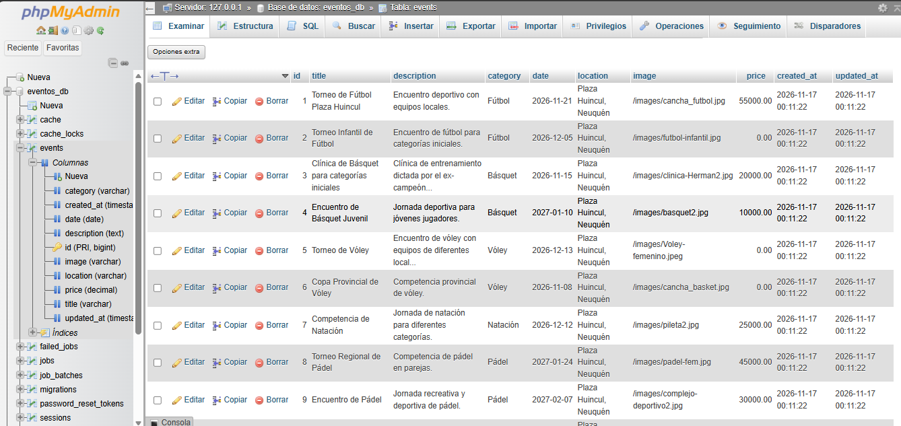
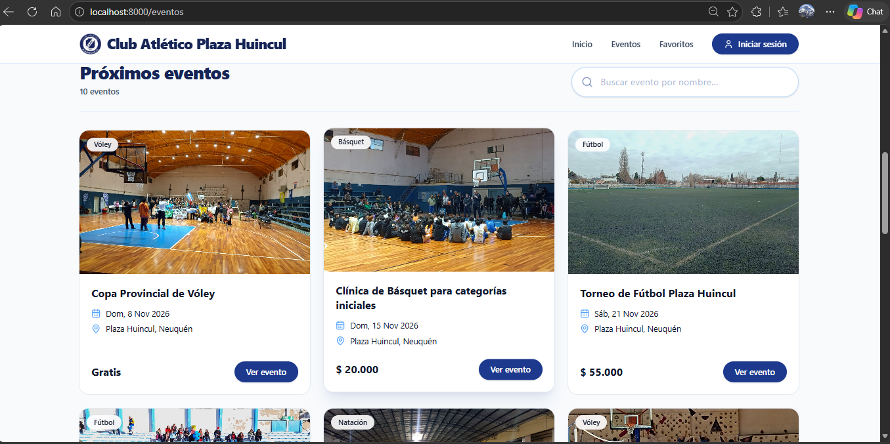

# Club Plaza — Eventos deportivos

Plataforma web para publicar y descubrir los eventos deportivos del **Club Atlético Plaza Huincul**: fútbol, básquet, vóley, natación, pádel y boxeo.

Proyecto integrador de **Programación Web Avanzada** (UNCo). En el TP3 se construyó el frontend con React y datos locales; en el TP4 los eventos pasan a leerse desde una base de datos MySQL usando Laravel como backend e Inertia.js para mostrarlos en React.

## Integrantes

| Nombre | Legajo |
|---|---|
| Dario Stefanovic | FAI-53732 |
| Tania Agüero | FAI-5692 |
| Jorge Medina | FAI-5713 |

## Tecnologías

- **Backend:** PHP 8.2, Laravel 12, Eloquent ORM
- **Base de datos:** MySQL (MariaDB vía XAMPP)
- **Puente backend–frontend:** Inertia.js
- **Frontend:** React, Tailwind CSS v4, Lucide React
- **Build:** Vite

## Cómo funciona

1. El navegador solicita `/eventos`.
2. La ruta de `routes/web.php` llama a `EventController@index`.
3. El controlador consulta el modelo `Event` (Eloquent), ordenado por fecha.
4. Los eventos se envían a React con `Inertia::render('Events/Index')`.
5. La página `Pages/Events/Index.jsx` los recibe como props y los muestra con los componentes del TP3.

## Requisitos

- PHP 8.2 o superior
- Composer
- Node.js y npm
- XAMPP (solo MySQL)

## Instalación y ejecución

```bash
git clone https://github.com/GABRIEL3503/eventos-app-club-plaza.git
cd eventos-app-club-plaza


composer install
npm install

cp .env.example .env
php artisan key:generate
```

Crear en phpMyAdmin una base de datos llamada `eventos_db` y luego:

```bash
php artisan migrate
php artisan db:seed --class=EventSeeder
```

Levantar el proyecto en **dos terminales**:

```bash
php artisan serve
```

```bash
npm run dev
```

Abrir http://localhost:8000/eventos

## Estructura principal

```
eventos-app/
├── app/
│   ├── Http/Controllers/EventController.php
│   └── Models/Event.php
├── database/
│   ├── migrations/xxxx_create_events_table.php
│   └── seeders/EventSeeder.php
├── docs/capturas/
├── public/images/
├── resources/
│   ├── css/app.css
│   ├── js/
│   │   ├── Components/
│   │   ├── data/categories.js
│   │   ├── Pages/Events/Index.jsx
│   │   ├── utils/format.js
│   │   └── app.jsx
│   └── views/app.blade.php
├── routes/web.php
└── .env.example
```

## Capturas

**Tabla `events` en phpMyAdmin**



**Página `/eventos`**

